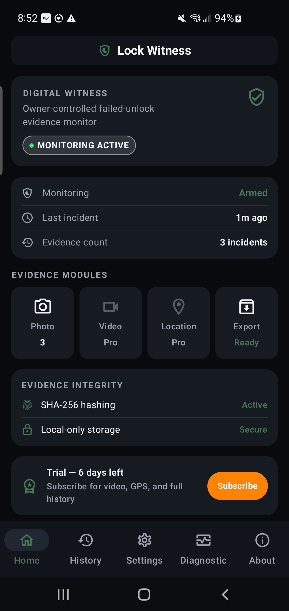
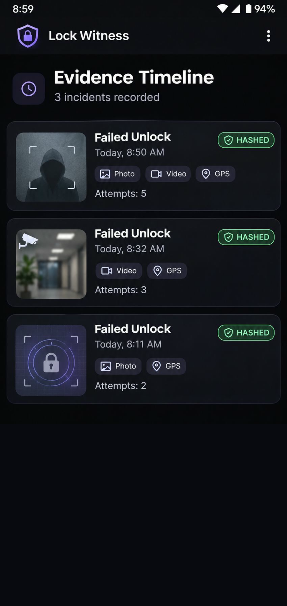
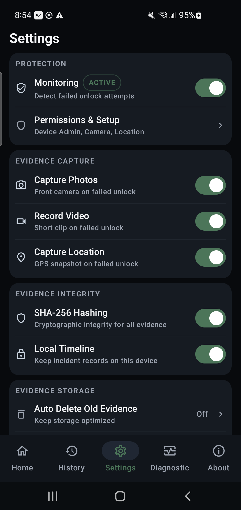

# LOCK WITNESS
### Your device. Your evidence. Your control.

**Native Android security software · Engineering and product portfolio by Locke Development · November 13, 2026**

**For prospective software-development clients and engineering employers:** a working Android product that combines hardware events, camera capture, on-device persistence, forensic-style hashing, portable evidence packages, permissions, UI state and commercial integration.

**[VIEW THE LIVE GOOGLE PLAY LISTING](https://play.google.com/store/apps/details?id=com.lockwitness.app)** · **[COMPARE FIVE COMPETITORS](COMPARISON.md)** · **[INSPECT ALL 336 INDIVIDUAL ITEMS](FEATURE-MATRIX.md)**

---

## When someone tries to unlock your phone, the evidence should belong to you

Lock Witness monitors failed attempts to unlock an Android phone using a PIN, password or pattern. With Device Admin and camera access approved by the owner, it creates a timestamped incident record, captures a front-camera image, and can also record a short silent video or available last-known location.

It keeps the evidence in private local storage and attaches **SHA-256 file fingerprints**. When the owner needs the record, the app creates a ZIP archive containing the media, `metadata.json`, `incidents.csv` and `hashes.txt`.

**There is no automatic email or cloud transmission in the inspected capture/export workflow.** Sharing is explicitly initiated by the person using the device.

## Product UI and privacy-safe illustrative incident timeline

| Dashboard | Evidence timeline | Settings |
|---|---|---|
|  |  |  |

**Privacy note:** The evidence-timeline image is a designed illustration with synthetic incident thumbnails, **not a real incident or forensic record**. The dashboard and settings images are existing source-controlled UI captures.

**[See the complete screenshot gallery](SCREENSHOTS.md)** · **[Install from Google Play](https://play.google.com/store/apps/details?id=com.lockwitness.app)**

## The six engineering capabilities demonstrated

| **01 · Android system integration** | Device Admin `onPasswordFailed` callbacks, monitoring preferences, Android foreground-camera service and notification |
|---|---|
| **02 · Reliable capture paths** | Camera2 photo and silent MP4, allowed duration choices, permission checks, camera timeout and distinct failure outcomes |
| **03 · Incident modeling** | Room persistence and DataStore settings; timestamp, attempt count, device, module state, capture result and evidence references |
| **04 · Verifiable file fingerprinting** | SHA-256 for photo/video, status-preserving evidence records and a manifest that can be checked against included file bytes |
| **05 · Owner-controlled delivery** | Offline ZIP with JSON/CSV/hash/media files, missing-media reporting, and user-selected Android share destination |
| **06 · Commercial/release work** | Compose UI, diagnostics, onboarding, trial/Pro gates, Play Billing 9.1.0, Android API 36, and recorded hardware/unit-test verification |

## Deliberate design choices

**Local by design.** This is not a cloud surveillance dashboard; files remain on the phone until an owner chooses to share them. Unlike automatic-email-first competitors, the baseline flow gives the device owner immediate discretion over when any evidence leaves the device.

**Silent video by design.** The manifest does not request microphone access. Video records visual evidence without audio capture.

**Detailed export by design.** Event CSV, JSON metadata, media files, fingerprints and missing-file notices make the package understandable and independently rehashable.

**Clear limits by design.** Biometric unlock failures are not observed by Android's credential-failure callback. Location is an available cached snapshot, not a guaranteed precise location taken at the instant of the attempt. A matching SHA-256 hash proves file-byte correspondence to a trusted reference; it is not a legal authenticity or chain-of-custody certificate.

## How Lock Witness compares

The five primary comparisons are **Lockwatch, CrookCatcher, Third Eye, WTMP (Mindfulness Devs), and Prey**. All have genuine strengths, and several have millions of installs.

Where they lead: **automatic off-device emails, cloud backup, device recovery, SIM/power alerts, remotely managed locking and in some cases audio video**.

Lock Witness's clearest evidence-backed position: **local evidence ownership, original-device retention, rich per-incident metadata, SHA-256 fingerprints and a human-controlled export package**. This does not mean competing apps are incapable of hashing or exporting; equivalence of their detailed internals has not been verified from their public information.

**[Read all 52 market-significant capability comparisons](COMPARISON.md)**

## A commercial Android release

Google Play lists the product as **Lock Witness**, with published Pro amounts **$2.99 monthly**, **$19.99 yearly** and **$39.99 lifetime**, plus a seven-day trial. The repository currently implements a local timer and trial-enabled Pro feature gating. Some older product descriptions conflict on whether trial access is base-only versus Pro and what remains free afterward, and actual Play purchases were not independently executed for this portfolio.

**[See the exact pricing/entitlement audit](MONETIZATION-AUDIT.md)** rather than using marketing claims that the present evidence cannot support.

## Proof beyond an app mockup

The source repository contains native Kotlin and Compose, Camera2, Room, DataStore, an actual Play Billing integration and Android 16 build configuration. Phase reports describe camera, video, local ZIP and hash-verification tests on Android 12 hardware and camera-service startup on an Android 16 emulator. The July release notes record **57 successful unit tests**; this audit did not rerun them.

There are **336 individual source-mapped features and gap entries**, separated into capture/storage evidence and user-interface/commercial operations. The product's strongest engineering story is not a large list of claimed functions: it is a **coherent native Android security event → captured media → recorded status → verifiable offline export flow**.

**[Open the feature-level audit](FEATURE-MATRIX.md)** · **[See verified runtime evidence](VERIFICATION-AND-STATUS.md)** · **[Read evidence-integrity limits](EVIDENCE-INTEGRITY.md)**

---

**For a software-development client:** evidence of building across Android platform integration, native UI, storage, device APIs, monetization and release/testing.

**For an employer:** evidence of engineering a working shipping product with permissions, structured status modeling, fallback states and an auditable verification history.

[**Google Play**](https://play.google.com/store/apps/details?id=com.lockwitness.app) · [**Source-backed methodology**](METHODOLOGY.md) · [**Public portfolio home**](README.md)

*Lock Witness is intended for devices the owner or authorized administrator controls. It is not a certified forensic laboratory, guaranteed theft-recovery system or guaranteed proof of a suspect's identity. No private source code or real customer evidence appears in this public portfolio.*
