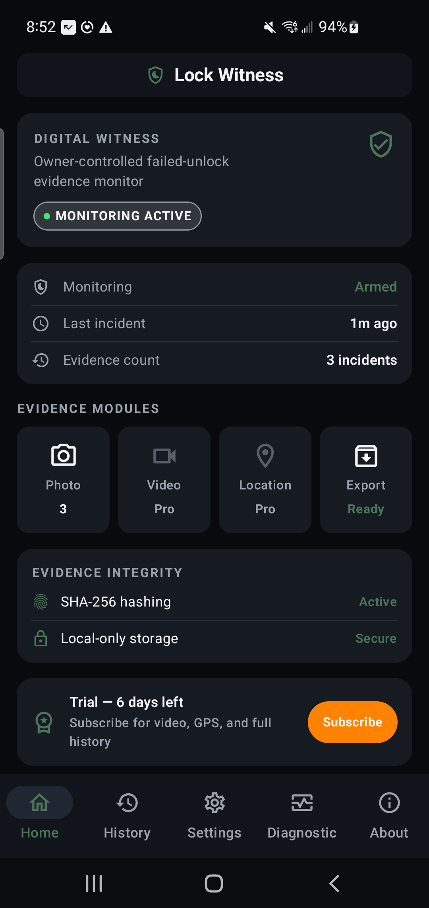
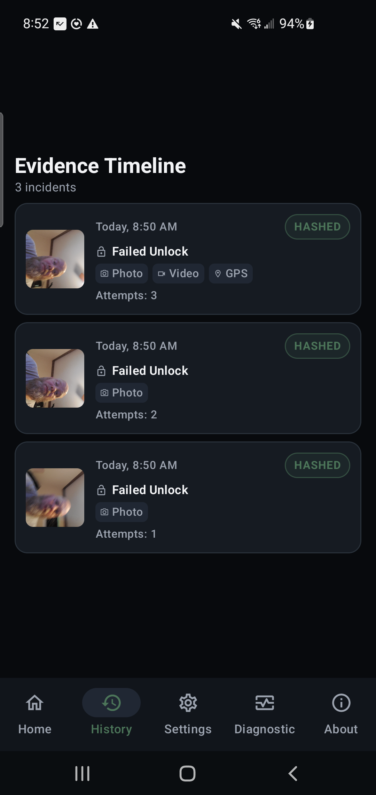
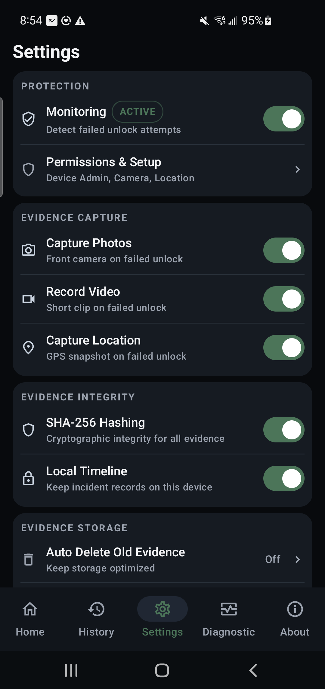

<h1 align="center">LOCK WITNESS</h1>

<strong>Your device. Your evidence. Your control.</strong>

<em>An owner-controlled Android security evidence recorder · Product engineering portfolio by Locke Development.</em>

<a href="https://play.google.com/store/apps/details?id=com.lockwitness.app">Get Lock Witness on Google Play</a> ·
<a href="BROCHURE.md">Portfolio brochure</a> ·
<a href="COMPARISON.md">Competitor comparison</a> ·
<a href="FEATURE-MATRIX.md">Individual feature audit</a> ·
<a href="VERIFICATION-AND-STATUS.md">Release status</a> ·
<a href="index.html">Visual brochure</a>

---

## Proof of an attempted unlock, recorded locally

**Lock Witness** responds to Android device-administrator **failed PIN, pattern or password** events. When the owner enables monitoring and grants the required permissions, the application can record a front-camera image, an optional **silent video**, a last-known location snapshot, and device/incident metadata. It stores evidence in app-private files and Room records, calculates SHA-256 fingerprints for captured photos and video, and lets the owner generate a ZIP package with evidence, CSV, JSON and a hash manifest.

The default architecture does **not** silently email evidence to the developer or upload it to a remote dashboard. Sharing takes an explicit user action through Android's chooser.

**[Google Play listing](https://play.google.com/store/apps/details?id=com.lockwitness.app)** · **[See current product presentation](BROCHURE.md)**

## What the current source demonstrates

| Product system | Engineering proof |
|---|---|
| **Device Admin event handling** | Android `onPasswordFailed`, failed-attempt count and foreground camera service |
| **Camera capture** | Camera2 front-camera JPEGs and optional silent MP4, permissions and timeout handling |
| **Location metadata** | LocationManager snapshot of the latest available permitted location; not remote live tracking |
| **Evidence integrity** | Per-file SHA-256, saved metadata, media statuses and manually verifiable export manifest |
| **Incident records** | Room database, timestamped history, incident details, per-media success/failure and delete controls |
| **Evidence delivery** | User-triggered ZIP with `metadata.json`, `incidents.csv`, `hashes.txt`, photo/video files |
| **User controls** | Compose dashboard, onboarding, granular settings, diagnostic checks and Android share chooser |
| **Commercial infrastructure** | Google Play Billing, entitlement checks and seven-day trial timer; live billing behavior not independently tested |

### Watch the actual screens

<strong>Source-controlled Android screen captures</strong>

| Dashboard | History | Settings |
|---|---|---|
|  |  |  |

The images originate in the application's repository; the portfolio does not imply every screenshot was recaptured from the July 2026 release.

## A full audit rather than a feature list

- **[Feature-by-feature register](FEATURE-MATRIX.md)** — specific source-mapped behaviors, including independently toggleable controls, incident data, image/video and location error states, export contents, diagnostics, billing and gaps.
- **[Competitive comparison](COMPARISON.md)** — Lockwatch, CrookCatcher, Third Eye, WTMP, and Prey, with explicit leads, category ties, competitor advantages and unknowns.
- **[Evidence mechanics](EVIDENCE-INTEGRITY.md)** — what SHA-256 does and does not prove; what goes into the ZIP; chain-of-custody limits.
- **[Verification and status](VERIFICATION-AND-STATUS.md)** — physical-device and emulator evidence, Play Store publication, release tests and unresolved billing/trial copy.

## Packaging and pricing

The current **Google Play listing** advertises a **seven-day trial**, **$2.99 monthly**, **$19.99 annually**, and **$39.99 lifetime**. These are *published offers*, not independently checked purchase flows. Current source code grants Pro feature access during the local trial timer and limits it after trial unless Pro is active; other repository marketing/checklist files conflict on whether the trial is base-only and what remains permanently free. **See [pricing reconciliation](MONETIZATION-AUDIT.md) before repeating more specific entitlement promises.**

## Release evidence

The inspected source is `Amishgangsta/LockWitness` at commit `8ca488aa8b1bdc53b7d2992ca91a436478fe227e`. The published Google Play app uses **Lock Witness** (two words), while the historic private source repository and Kotlin package use **LockWitness** without a space. The README describes **v1.0.4 / versionCode 5, Android target API 36, Billing 9.1.0 and 57 passing unit tests as of July 22, 2026**; existing build evidence is reviewed, not rerun here.

**[Read the brochure](BROCHURE.md)** · **[View the original source-referenced audit](METHODOLOGY.md)**

---

Lock Witness is a device-owner security utility, not an automatic cloud backup, theft-recovery guarantee, certified forensic laboratory, or legal admissibility certification. Android may restrict background capture or location access. It cannot detect biometric failures through the standard Android failed-password callback. Private production source and user evidence are not included in this public repository.
