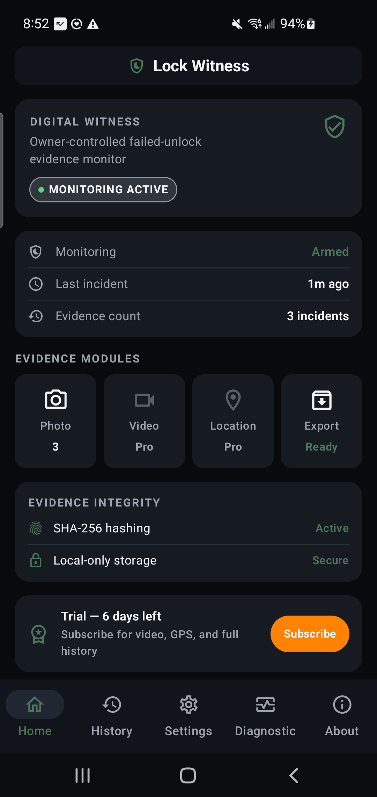
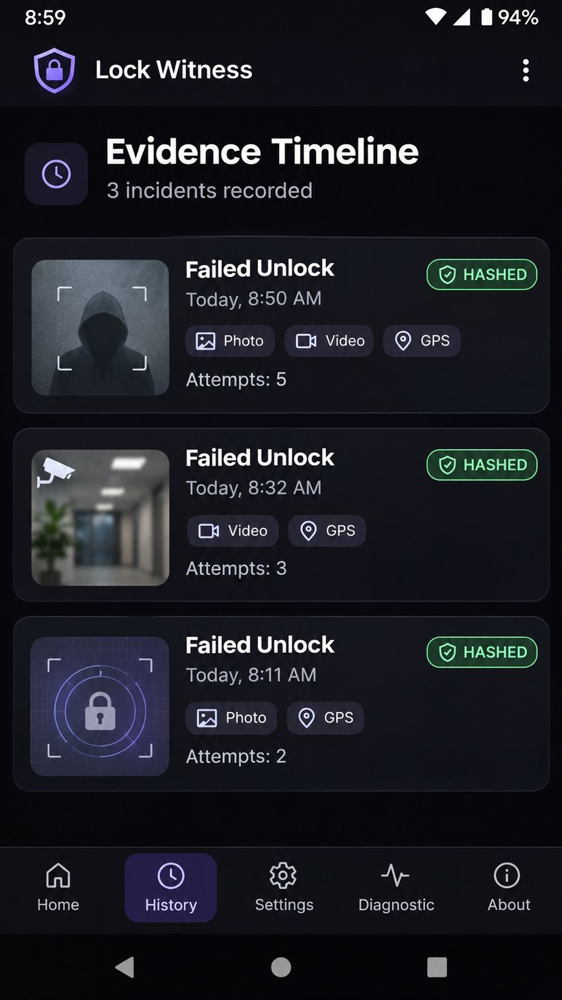
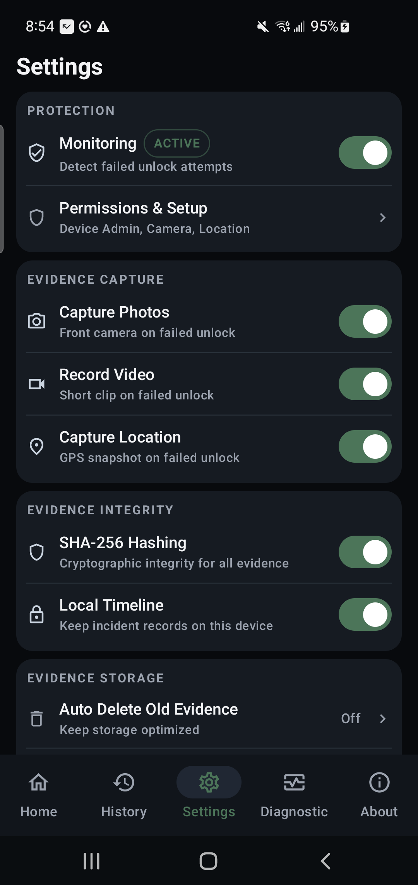
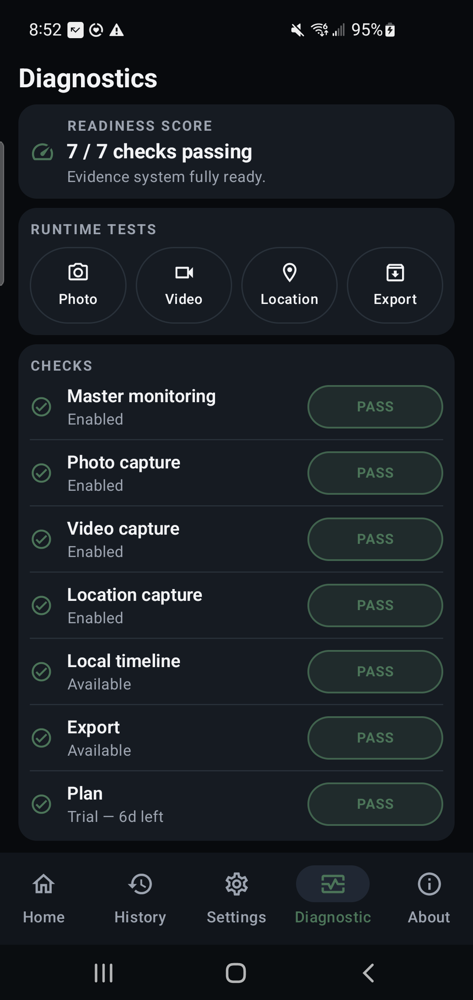
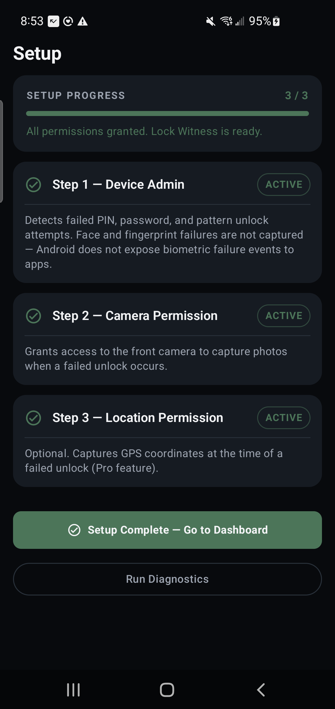

# Lock Witness — Product UI Gallery and Illustrative Timeline

The dashboard, settings, diagnostics and setup images come from the app's private repository at source snapshot `8ca488aa8b1bdc53b7d2992ca91a436478fe227e`. The **incident-history image is an illustrative reconstruction with synthetic placeholder thumbnails**, replacing the original test image containing a personal photograph. It is **not genuine incident evidence or a fresh Android 16 production screenshot**. The product name is **Lock Witness**.

## Monitoring dashboard

Monitoring status, recent event, evidence count, modules, and the integrity/trial summary are visible together.

## Illustrative incident timeline — synthetic image

Illustrative timeline cards showing failed-attempt metadata and hash status. The thumbnails and sample event content are **fabricated for the presentation**, not authentic captured evidence.

## Feature controls

Independent toggles for monitoring, camera, video, location, hashing and local timeline. The presence of an auto-delete choice does not itself prove automatic retention cleanup is running.

## Diagnostics

Readiness checks, capture test actions and reported pass/fail state. The displayed example is from an earlier development verification.

## Device permission setup

Explicit Device Admin, Camera and optional Location permission steps. Screen-lock credential failures are supported; biometric failure detection is not.

## Application icon

[**Install Lock Witness on Google Play**](https://play.google.com/store/apps/details?id=com.lockwitness.app) · [**Portfolio brochure**](BROCHURE.md) · [**Actual source verification**](VERIFICATION-AND-STATUS.md)
